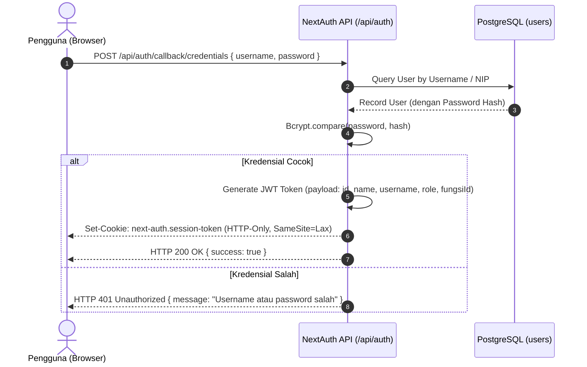

# DOKUMENTASI SPESIFIKASI API & KONTRAK KOMUNIKASI (API.MD)
# SIPBAR WEB — SISTEM INFORMASI PERSEDIAAN BARANG
**Badan Pusat Statistik (BPS) Kabupaten Jeneponto**
*Dokumen Standar REST API, Server Actions, Skema Validasi, dan Protokol Komunikasi Data*

---

## 1. API OVERVIEW

### 1.1 Tujuan API
Dokumen ini mendefinisikan kontrak komunikasi resmi (*Interface Contract*) antara lapisan antarmuka pengguna (*Frontend UI*), lapisan pemrosesan server (*Next.js Server Actions & API Routes*), dan basis data PostgreSQL untuk aplikasi **SIPBAR Web** di BPS Kabupaten Jeneponto.

### 1.2 Base URL & Environment
* **Jaringan Lokal Kantor (LAN BPS)**: `http://192.168.1.50:3000/api`
* **Akses Jarak Jauh (Ngrok Tunneling)**: `https://sipbar-bps-jeneponto.ngrok-free.app/api`
* **Development Lokal**: `http://localhost:3000/api`

### 1.3 Format Standar Respons (Standard Response Envelope)
Seluruh respons API dan Server Actions menggunakan format JSON terstandarisasi:

#### A. Respons Sukses (`HTTP 200 / 201`)
```json
{
  "success": true,
  "message": "Operasi berhasil dieksekusi",
  "data": {},
  "meta": {
    "page": 1,
    "limit": 10,
    "totalItems": 316,
    "totalPages": 32
  }
}
```

#### B. Respons Gagal / Error (`HTTP 400 / 401 / 403 / 404 / 422 / 500`)
```json
{
  "success": false,
  "errorCode": "INSUFFICIENT_STOCK",
  "message": "Kuantitas pengeluaran melebihi sisa stok yang tersedia",
  "errors": {
    "jumlahKeluar": ["Stok fisik hanya tersisa 2 unit"]
  }
}
```

---

## 2. AUTHENTICATION & SESSION PROTOCOL

Aplikasi menggunakan **NextAuth.js v5** berbasis **Credentials Provider** dengan sesi terenkripsi **JSON Web Token (JWT)** yang disimpan dalam cookie aman (*HTTP-Only Secure Cookie*).

### 2.1 Mekanisme Alur Autentikasi


### 2.2 Sesi Pengguna (Session Payload)
Token JWT menyimpan klaim pengguna yang dapat dibaca di sisi server untuk otorisasi:
```typescript
interface UserSession {
  id: string;
  name: string;
  username: string;
  nip?: string;
  role: "SUPER_ADMIN" | "ADMIN_GUDANG" | "PEGAWAI";
  fungsiId?: string;
}
```

---

## 3. AUTHORIZATION & ROLE MATRIX

| Endpoint Group / Action | SUPER_ADMIN | ADMIN_GUDANG | PEGAWAI | PUBLIC (LAN) |
| :--- | :---: | :---: | :---: | :---: |
| **Katalog Stok (`GET /api/katalog`)** | ✅ | ✅ | ✅ | ✅ |
| **Dasbor Analitik (`GET /api/dashboard/*`)** | ✅ | ✅ | ❌ | ❌ |
| **Master Barang (CRUD `/api/barang`)** | ✅ | ✅ | ❌ | ❌ |
| **Barang Masuk (CRUD `/api/transaksi-masuk`)** | ✅ | ✅ | ❌ | ❌ |
| **Barang Keluar (CRUD `/api/transaksi-keluar`)** | ✅ | ✅ | ❌ | ❌ |
| **Tanda Terima (`POST /api/tanda-terima`)** | ✅ | ✅ | ❌ | ❌ |
| **Ekspor Laporan (`GET /api/export/*`)** | ✅ | ✅ | ❌ | ❌ |
| **Manajemen User (CRUD `/api/users`)** | ✅ | ❌ | ❌ | ❌ |
| **Master Referensi (CRUD `/api/referensi/*`)** | ✅ | ✅ | ❌ | ❌ |

---

## 4. ENDPOINT SPECIFICATIONS

---

### 4.1 Modul Autentikasi (`/api/auth`)

#### `POST /api/auth/login`
* **Tujuan**: Masuk ke dalam sistem.
* **Akses**: Publik.
* **Request Body**:
  ```json
  {
    "username": "azizah",
    "password": "password123"
  }
  ```
* **Validation**:
  * `username`: Wajib, string minimal 3 karakter.
  * `password`: Wajib, string minimal 6 karakter.
* **HTTP Status**:
  * `200 OK`: Login berhasil, sesi aktif.
  * `401 Unauthorized`: Kredensial tidak valid.

#### `POST /api/auth/logout`
* **Tujuan**: Menghapus sesi dan keluar dari sistem.
* **Akses**: Seluruh user terautentikasi.
* **HTTP Status**: `200 OK` (Cookie sesi dihapus).

---

### 4.2 Modul Katalog Publik & Pencarian (`/api/katalog`)

#### `GET /api/katalog`
* **Tujuan**: Mengambil daftar katalog persediaan untuk seluruh staf pegawai.
* **Akses**: Publik / Seluruh Pengguna.
* **Query Parameters**:
  * `search` (*string*, opsional): Kata kunci nama barang.
  * `kategoriId` (*string*, opsional): Filter kategori barang.
  * `gudangId` (*string*, opsional): Filter lokasi gudang.
  * `status` (*string*, opsional): Filter `TERSEDIA`, `MENIPIS`, `HABIS`.
  * `page` (*integer*, default: `1`): Nomor halaman.
  * `limit` (*integer*, default: `12`): Jumlah item per halaman.
* **Response `200 OK`**:
  ```json
  {
    "success": true,
    "data": [
      {
        "id": "cly123abc",
        "kodeBarang": "ID-1000001",
        "namaBarang": "Kertas A4 75 Gsm",
        "kategori": { "id": "kat1", "nama": "Kertas HVS" },
        "satuan": { "id": "sat1", "nama": "Rim" },
        "gudang": { "id": "gud2", "nama": "Gudang 2" },
        "stok": 6,
        "minStok": 5,
        "statusStok": "TERSEDIA",
        "gambarUrl": null
      }
    ],
    "meta": {
      "page": 1,
      "limit": 12,
      "totalItems": 316,
      "totalPages": 27
    }
  }
  ```

---

### 4.3 Modul Master Barang (`/api/barang`)

#### `POST /api/barang` (atau Server Action `createBarang`)
* **Tujuan**: Menambah item master barang baru ke katalog.
* **Akses**: `ADMIN_GUDANG`, `SUPER_ADMIN`.
* **Request Body**:
  ```json
  {
    "namaBarang": "Tinta Printer Epson 003 Black",
    "kategoriId": "kat_tinta_123",
    "satuanId": "sat_botol_123",
    "gudangId": "gud_gudang2_123",
    "minStok": 5,
    "hargaEstimasi": 85000,
    "gambarUrl": null
  }
  ```
* **Business Logic**:
  1. Generate `kodeBarang` otomatis sekuensial (`ID-1000xxx`).
  2. Inisialisasi saldo fisik awal `stok = 0`.
  3. Simpan record ke tabel `barang`.
* **HTTP Status**:
  * `201 Created`: Barang berhasil didaftarkan.
  * `422 Unprocessable Entity`: Validasi input gagal.

#### `PUT /api/barang/{id}` (atau Server Action `updateBarang`)
* **Tujuan**: Mengubah identitas master barang.
* **Akses**: `ADMIN_GUDANG`, `SUPER_ADMIN`.
* **Path Parameter**: `id` (String CUID barang).
* **Request Body**: Sama seperti POST *(Catatan: Nilai `stok` tidak boleh diubah langsung via endpoint ini)*.
* **HTTP Status**: `200 OK` / `404 Not Found`.

#### `DELETE /api/barang/{id}` (atau Server Action `deleteBarang`)
* **Tujuan**: Menghapus master barang yang belum pernah memiliki riwayat transaksi.
* **Akses**: `ADMIN_GUDANG`, `SUPER_ADMIN`.
* **Business Logic**:
  * Cek apakah ada record di `transaksi_masuk` atau `transaksi_keluar` untuk `barangId`.
  * Jika ada riwayat transaksi $\rightarrow$ Tolak penghapusan (`HTTP 400 Bad Request` dengan pesan: *"Barang tidak dapat dihapus karena memiliki riwayat transaksi"*).
  * Jika belum ada riwayat $\rightarrow$ Hapus record.
* **HTTP Status**: `200 OK` / `400 Bad Request` / `404 Not Found`.

---

### 4.4 Modul Transaksi Barang Masuk (`/api/transaksi-masuk`)

#### `GET /api/transaksi-masuk`
* **Tujuan**: Mengambil daftar riwayat perolehan barang masuk.
* **Akses**: `ADMIN_GUDANG`, `SUPER_ADMIN`.
* **Query Parameters**: `search`, `barangId`, `startDate`, `endDate`, `page`, `limit`.
* **Response `200 OK`**:
  ```json
  {
    "success": true,
    "data": [
      {
        "id": "txm_001",
        "kodeTransaksi": "BM-202610-0001",
        "tanggal": "2026-10-08T00:00:00.000Z",
        "barang": {
          "id": "cly123abc",
          "kodeBarang": "ID-1000001",
          "namaBarang": "Kertas A4 75 Gsm",
          "satuan": { "nama": "Rim" }
        },
        "jumlahMasuk": 10,
        "hargaBeli": 550000,
        "sumberPengadaan": "DIPA BPS 2026",
        "createdBy": { "name": "Nur Azizah Tajuddin" }
      }
    ]
  }
  ```

#### `POST /api/transaksi-masuk` (atau Server Action `createTransaksiMasuk`)
* **Tujuan**: Mencatat pengadaan barang dan menambah stok fisik secara otomatis.
* **Akses**: `ADMIN_GUDANG`, `SUPER_ADMIN`.
* **Request Body**:
  ```json
  {
    "tanggal": "2026-10-08",
    "barangId": "cly123abc",
    "jumlahMasuk": 10,
    "hargaBeli": 550000,
    "sumberPengadaan": "Pengadaan ATK DIPA",
    "keterangan": "Nota No. 102/ATK/X/2026"
  }
  ```
* **Business Logic (ACID Transaction)**:
  1. Generate `kodeTransaksi` (`BM-YYYYMM-xxxx`).
  2. Buka blok `prisma.$transaction`.
  3. `INSERT INTO transaksi_masuk`.
  4. `UPDATE barang SET stok = stok + jumlahMasuk WHERE id = barangId`.
  5. Commit transaksi.
* **HTTP Status**: `201 Created` / `422 Validation Error`.

---

### 4.5 Modul Transaksi Barang Keluar (`/api/transaksi-keluar`)

#### `GET /api/transaksi-keluar`
* **Tujuan**: Mengambil daftar riwayat pengeluaran barang ke pegawai/seksi.
* **Akses**: `ADMIN_GUDANG`, `SUPER_ADMIN`.
* **Query Parameters**: `search`, `barangId`, `fungsiId`, `penerimaNama`, `startDate`, `endDate`, `hasTandaTerima` (boolean), `page`, `limit`.

#### `POST /api/transaksi-keluar` (atau Server Action `createTransaksiKeluar`)
* **Tujuan**: Mencatat penyaluran barang dan memotong stok fisik secara otomatis.
* **Akses**: `ADMIN_GUDANG`, `SUPER_ADMIN`.
* **Request Body**:
  ```json
  {
    "tanggal": "2026-10-08",
    "barangId": "cly123abc",
    "jumlahKeluar": 3,
    "penerimaNama": "Sapril, A.Md.Kom",
    "penerimaNip": "199201012015011001",
    "fungsiId": "fng_ipds_123",
    "keterangan": "Kebutuhan kegiatan sensus lapangan"
  }
  ```
* **Business Logic (ACID Transaction)**:
  1. Generate `kodeTransaksi` (`BK-YYYYMM-xxxx`).
  2. Buka blok `prisma.$transaction`.
  3. Query `barang` by ID dan kunci baris data.
  4. **Validasi Kritis**: Jika `barang.stok < jumlahKeluar`, lempar error `INSUFFICIENT_STOCK` dan rollback.
  5. Jika cukup: `INSERT INTO transaksi_keluar`.
  6. `UPDATE barang SET stok = stok - jumlahKeluar WHERE id = barangId`.
  7. Commit transaksi.
* **HTTP Status**:
  * `201 Created`: Transaksi pengeluaran berhasil dicatat.
  * `400 Bad Request`: Stok tidak mencukupi.
  * `422 Unprocessable Entity`: Data form tidak lengkap.

---

### 4.6 Modul Generator Tanda Terima (`/api/tanda-terima`)

#### `POST /api/tanda-terima` (atau Server Action `createTandaTerima`)
* **Tujuan**: Mengompilasi satu atau beberapa transaksi pengeluaran barang menjadi Berita Acara resmi.
* **Akses**: `ADMIN_GUDANG`, `SUPER_ADMIN`.
* **Request Body**:
  ```json
  {
    "tanggalDokumen": "2026-10-08",
    "transaksiKeluarIds": ["txk_001", "txk_002", "txk_003"],
    "kasubbagNama": "Imaniar Dwi Aryanti, S.TP",
    "kasubbagNip": "199001012015012001",
    "kasubbagJabatan": "Kepala Subbagian Umum BPS Kabupaten Jeneponto"
  }
  ```
* **Business Logic**:
  1. Generate nomor dokumen (`TT-YYYYMM-xxxx`).
  2. Simpan record ke tabel `tanda_terima`.
  3. Update `transaksi_keluar` terpilih: set `tanda_terima_id = tandaTerima.id`.
* **HTTP Status**: `201 Created` / `400 Bad Request`.

#### `GET /api/tanda-terima/{id}`
* **Tujuan**: Mengambil detail lengkap Berita Acara Tanda Terima beserta seluruh item barang untuk dirender ke format cetak F4/A4 atau diunduh sebagai PDF.
* **Akses**: `ADMIN_GUDANG`, `SUPER_ADMIN`, `PEGAWAI` (jika namanya terdaftar sebagai penerima).
* **Response `200 OK`**:
  ```json
  {
    "success": true,
    "data": {
      "id": "tt_001",
      "nomorDokumen": "TT-202610-0001",
      "tanggalDokumen": "2026-10-08T00:00:00.000Z",
      "kasubbagNama": "Imaniar Dwi Aryanti, S.TP",
      "kasubbagJabatan": "Kepala Subbagian Umum BPS Kabupaten Jeneponto",
      "items": [
        {
          "id": "txk_001",
          "kodeTransaksi": "BK-202610-0001",
          "namaBarang": "Kertas A4 75 Gsm",
          "jumlahKeluar": 3,
          "satuan": "Rim",
          "tanggal": "2026-10-08",
          "penerimaNama": "Sapril, A.Md.Kom",
          "fungsi": "IPDS"
        }
      ]
    }
  }
  ```

---

### 4.7 Modul Dasbor & Laporan (`/api/dashboard` & `/api/export`)

#### `GET /api/dashboard/stats`
* **Tujuan**: Mengambil metrik agregat KPI untuk kartu dasbor utama.
* **Akses**: `ADMIN_GUDANG`, `SUPER_ADMIN`.
* **Response `200 OK`**:
  ```json
  {
    "success": true,
    "data": {
      "totalVarianBarang": 316,
      "totalSaldoFisik": 489,
      "totalMasukBulanIni": 15,
      "totalKeluarBulanIni": 28,
      "gudangStats": [
        { "gudangNama": "Gudang 1", "totalStok": 0 },
        { "gudangNama": "Gudang 2", "totalStok": 489 },
        { "gudangNama": "Gudang 3", "totalStok": 0 }
      ],
      "totalLowStock": 12
    }
  }
  ```

#### `GET /api/dashboard/low-stock`
* **Tujuan**: Mengambil daftar barang kritis (`stok <= minStok`) untuk tabel peringatan dasbor.
* **Akses**: `ADMIN_GUDANG`, `SUPER_ADMIN`.

#### `GET /api/export/excel`
* **Tujuan**: Mengekspor laporan rekapitulasi mutasi ke format file Excel `.xlsx`.
* **Akses**: `ADMIN_GUDANG`, `SUPER_ADMIN`.
* **Query Parameters**:
  * `jenis`: `masuk` atau `keluar`.
  * `startDate`: Format `YYYY-MM-DD`.
  * `endDate`: Format `YYYY-MM-DD`.
* **Response**: Binary Stream `application/vnd.openxmlformats-officedocument.spreadsheetml.sheet` dengan header `Content-Disposition: attachment; filename="Laporan_Mutasi_Persediaan_BPS.xlsx"`.

---

### 4.8 Modul Pengaturan Pengguna (`/api/users`)

#### `GET /api/users`
* **Tujuan**: Mengambil daftar seluruh akun pegawai dan role-nya.
* **Akses**: `SUPER_ADMIN` (Khusus Tim IT).

#### `POST /api/users`
* **Tujuan**: Mendaftarkan akun pegawai baru.
* **Akses**: `SUPER_ADMIN`.
* **Request Body**:
  ```json
  {
    "username": "nur_liana",
    "name": "Nur Lianasari A.Md.Stat",
    "nip": "199501012018012002",
    "password": "TemporaryPassword123!",
    "role": "PEGAWAI",
    "fungsiId": "fng_produksi_123"
  }
  ```
* **HTTP Status**: `201 Created` / `400 Bad Request` (Username/NIP sudah ada).

#### `POST /api/users/{id}/reset-password`
* **Tujuan**: Mereset kata sandi pegawai yang lupa password.
* **Akses**: `SUPER_ADMIN`.
* **Request Body**: `{ "newPassword": "NewSecurePassword123!" }`
* **HTTP Status**: `200 OK`.

---

### 4.9 Modul Upload Berkas (`/api/upload/image`)

#### `POST /api/upload/image`
* **Tujuan**: Mengunggah foto barang persediaan atau avatar pengguna.
* **Akses**: `ADMIN_GUDANG`, `SUPER_ADMIN`.
* **Content-Type**: `multipart/form-data`
* **Validasi File**:
  * Format yang diperbolehkan: `image/jpeg`, `image/png`, `image/webp`.
  * Ukuran Maksimum: **2 MB**.
  * File disimpan pada direktori aman server `/public/uploads/...`.
* **Response `200 OK`**:
  ```json
  {
    "success": true,
    "data": {
      "fileUrl": "/uploads/barang/img-1728381234.webp"
    }
  }
  ```

---

### 4.10 Modul Health Check (`/api/health`)

#### `GET /api/health`
* **Tujuan**: Monitoring kesehatan container dan konektivitas database oleh Docker daemon.
* **Akses**: Publik.
* **Response `200 OK`**:
  ```json
  {
    "status": "UP",
    "timestamp": "2026-10-08T13:45:00.000Z",
    "database": "CONNECTED",
    "uptimeSeconds": 86400
  }
  ```

---

## 5. STANDARD ERROR CODES & HTTP STATUS

| HTTP Status | Error Code | Deskripsi Skenario |
| :---: | :--- | :--- |
| **`400`** | `INSUFFICIENT_STOCK` | Kuantitas keluar melebihi stok fisik yang tersedia. |
| **`400`** | `HAS_TRANSACTION_HISTORY` | Barang tidak boleh dihapus karena memiliki riwayat mutasi. |
| **`401`** | `UNAUTHORIZED` | Pengguna belum login atau token sesi kadaluarsa. |
| **`403`** | `FORBIDDEN` | Pengguna tidak memiliki role perizinan untuk mengakses resource. |
| **`404`** | `RESOURCE_NOT_FOUND` | ID Barang, Transaksi, atau User tidak ditemukan di database. |
| **`409`** | `DUPLICATE_ENTRY` | Username, NIP, atau Kode Barang sudah terdaftar. |
| **`422`** | `VALIDATION_ERROR` | Format data body tidak lolos validasi skema Zod. |
| **`500`** | `INTERNAL_SERVER_ERROR` | Kesalahan internal server / koneksi basis data terputus. |

---

## 6. PAGINATION, FILTERING & SORTING STANDARD

### 6.1 Format Standar Query String
Setiap endpoint list/tabel mendukung query string standar:
```
GET /api/resource?page=1&limit=10&search=kertas&sortBy=createdAt&sortOrder=desc
```

### 6.2 Format Standar Metadata Response
```json
"meta": {
  "page": 1,
  "limit": 10,
  "totalItems": 316,
  "totalPages": 32,
  "hasNextPage": true,
  "hasPrevPage": false
}
```

---

## 7. API SECURITY & RATE LIMITING

1. **Proteksi Password**: Field `password` pada tabel `users` **dilarang keras disertakan dalam output JSON** seluruh endpoint (`select: { password: false }`).
2. **Rate Limiting**: Endpoint autentikasi `/api/auth/*` dibatasi maksimal **10 percobaan per menit** per IP address untuk mencegah serangan *brute force*.
3. **CORS Policy**: Secara default API hanya menerima request dari origin aplikasi yang sama (`Same-Origin`), dan mengizinkan tunnel Ngrok resmi BPS Jeneponto.
4. **Sanitasi Data Input**: Seluruh input teks dibersihkan dari tag HTML/script berbahaya menggunakan validator Zod untuk menangkal serangan *Cross-Site Scripting (XSS)*.

---

## 8. KESIMPULAN KONTRAK API

Dokumen spesifikasi **`API.md`** ini mengunci seluruh kontrak endpoint, skema request/response, dan alur transaksi atomik yang dibutuhkan oleh **SIPBAR Web**. Dengan adanya spesifikasi ini, pengembang frontend dan backend memiliki panduan komunikasi data yang presisi, bebas dari ambiguitas, dan siap diimplementasikan secara langsung.
