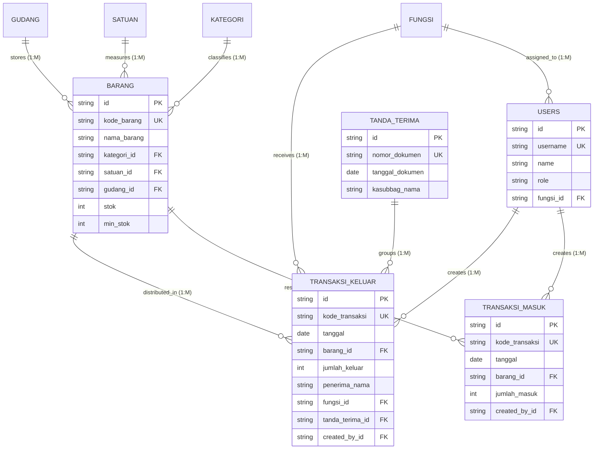

# DOKUMENTASI RANCANGAN BASIS DATA (DATABASE DESIGN)
# SIPBAR WEB — SISTEM INFORMASI PERSEDIAAN BARANG
**Badan Pusat Statistik (BPS) Kabupaten Jeneponto**
*Dokumen Spesifikasi Struktur Data, Skema Relasional, Indeks, Integritas Transaksional, dan Kebijakan Migrasi*

---

## 1. DATABASE OVERVIEW

### 1.1 Database Management System (DBMS)
* **DBMS Utama**: **PostgreSQL 16 (Alpine Linux Container)**
* **Object-Relational Mapping (ORM)**: **Prisma ORM 5.x** (Node.js / TypeScript)
* **Driver Koneksi**: PostgreSQL Native TCP Connection (`postgresql://...`)

### 1.2 Tujuan dan Karakteristik Basis Data
Database SIPBAR Web dirancang untuk menyimpan dan mengelola seluruh data persediaan logistik BPS Kabupaten Jeneponto dengan karakteristik:
1. **Kepatuhan Transaksi ACID (*Atomicity, Consistency, Isolation, Durability*)**: Menjamin setiap transaksi masuk dan keluar memutasi saldo fisik persediaan secara atomik tanpa risiko *race condition* atau korupsi saldo stok.
2. **Integritas Referensial Ketat (*Strict Foreign Key Constraints*)**: Mencegah penghapusan data master yang masih memiliki keterikatan riwayat transaksi masa lalu.
3. **Optimasi Kueri Pencarian (*Search Indexing*)**: Menyediakan indeks B-Tree pada nama barang, kategori, dan rentang tanggal transaksi untuk pencarian instan berkecepatan tinggi ($< 150$ ms).
4. **Audit Trail Penuh**: Merekam jejak audit waktu pembuatan (*timestamps*) dan identitas pengguna pembuat (*user tracking*) pada setiap mutasi persediaan.

---

## 2. ENTITY & DATA MODEL

Terdapat **9 entitas tabel utama** yang memodelkan seluruh siklus persediaan barang di BPS Kabupaten Jeneponto:

```
+----------------------------------------------------------------------------------------------------+
|                                    DAFTAR ENTITAS BASIS DATA                                       |
+----------------------------------------------------------------------------------------------------+
| 1. users            : Menyimpan data akun pengguna, kredensial hash, role (RBAC), dan NIP pegawai. |
| 2. fungsi           : Master data seksi/unit kerja di lingkungan BPS Kabupaten Jeneponto.          |
| 3. kategori         : Master klasifikasi/jenis barang (Kertas HVS, Tinta/Toner, Stopmap, dll).     |
| 4. satuan           : Master satuan unit kemasan barang (Rim, Botol, Buah, Pack, Box, dll).       |
| 5. gudang           : Master lokasi fisik penyimpanan barang (Gudang 1, Gudang 2, Gudang 3).      |
| 6. barang           : Master katalog barang persediaan, saldo fisik terkini, dan batas stok kritis.|
| 7. transaksi_masuk  : Log riwayat perolehan/penerimaan barang masuk (restocking / DIPA).          |
| 8. transaksi_keluar : Log riwayat penyaluran/distribusi barang ke pegawai dan seksi kerja.         |
| 9. tanda_terima     : Dokumen Berita Acara / Tanda Terima resmi pengesahan penyerahan barang.       |
+----------------------------------------------------------------------------------------------------+
```

---

## 3. TABLE SPECIFICATIONS

### 3.1 Tabel: `users`
Menyimpan akun pengguna, hak akses, dan keterikatan dengan unit kerja internal.
* **Nama Tabel Fisik**: `users`
* **Prisma Model**: `User`

| Nama Kolom | Tipe Data SQL | Prisma Type | Nullable | Default | Constraints / Index | Keterangan |
| :--- | :--- | :--- | :---: | :---: | :---: | :--- |
| `id` | `VARCHAR(30)` | `String` | No | `cuid()` | **PK** | Identifier unik akun pengguna |
| `username` | `VARCHAR(50)` | `String` | No | - | **UNIQUE**, Index | Username login (misal: `azizah`) |
| `name` | `VARCHAR(100)` | `String` | No | - | - | Nama lengkap pegawai & gelar |
| `nip` | `VARCHAR(20)` | `String` | Yes | `NULL` | **UNIQUE**, Index | NIP resmi pegawai BPS |
| `password` | `VARCHAR(255)` | `String` | No | - | - | Hash kata sandi (Bcrypt 12 rounds) |
| `role` | `VARCHAR(20)` | `Role (Enum)`| No | `'PEGAWAI'` | - | Nilai: `SUPER_ADMIN`, `ADMIN_GUDANG`, `PEGAWAI` |
| `avatar` | `VARCHAR(255)` | `String` | Yes | `NULL` | - | URL path foto profil pengguna |
| `fungsi_id` | `VARCHAR(30)` | `String` | Yes | `NULL` | **FK** $\rightarrow$ `fungsi.id` | Seksi/unit kerja asal pegawai |
| `created_at` | `TIMESTAMP(3)` | `DateTime` | No | `now()` | - | Waktu pendaftaran akun |
| `updated_at` | `TIMESTAMP(3)` | `DateTime` | No | `now()` | - | Waktu pembaruan akun terakhir |

---

### 3.2 Tabel: `fungsi`
Menyimpan daftar seksi dan unit kerja struktural di BPS Kabupaten Jeneponto.
* **Nama Tabel Fisik**: `fungsi`
* **Prisma Model**: `Fungsi`

| Nama Kolom | Tipe Data SQL | Prisma Type | Nullable | Default | Constraints / Index | Keterangan |
| :--- | :--- | :--- | :---: | :---: | :---: | :--- |
| `id` | `VARCHAR(30)` | `String` | No | `cuid()` | **PK** | Identifier unik seksi/fungsi |
| `nama` | `VARCHAR(50)` | `String` | No | - | **UNIQUE** | Nama unit kerja (misal: `UMUM`, `PRODUKSI`, `DISTRIBUSI`) |
| `kode` | `VARCHAR(20)` | `String` | No | - | **UNIQUE** | Kode singkatan seksi (misal: `IPDS`, `SOS`, `NER`) |

---

### 3.3 Tabel: `kategori`
Menyimpan daftar klasifikasi jenis barang persediaan (27+ kategori standar BPS).
* **Nama Tabel Fisik**: `kategori`
* **Prisma Model**: `Kategori`

| Nama Kolom | Tipe Data SQL | Prisma Type | Nullable | Default | Constraints / Index | Keterangan |
| :--- | :--- | :--- | :---: | :---: | :---: | :--- |
| `id` | `VARCHAR(30)` | `String` | No | `cuid()` | **PK** | Identifier unik kategori |
| `nama` | `VARCHAR(100)` | `String` | No | - | **UNIQUE**, Index | Nama jenis barang (misal: `Kertas HVS`, `Tinta/Toner`) |
| `deskripsi` | `TEXT` | `String` | Yes | `NULL` | - | Keterangan tambahan kategori |

---

### 3.4 Tabel: `satuan`
Menyimpan master satuan unit kemasan distribusi barang (14+ satuan standar BPS).
* **Nama Tabel Fisik**: `satuan`
* **Prisma Model**: `Satuan`

| Nama Kolom | Tipe Data SQL | Prisma Type | Nullable | Default | Constraints / Index | Keterangan |
| :--- | :--- | :--- | :---: | :---: | :---: | :--- |
| `id` | `VARCHAR(30)` | `String` | No | `cuid()` | **PK** | Identifier unik satuan |
| `nama` | `VARCHAR(30)` | `String` | No | - | **UNIQUE** | Nama satuan unit (misal: `Rim`, `Botol`, `Pack`, `Box`) |

---

### 3.5 Tabel: `gudang`
Menyimpan lokasi fisik ruang penyimpanan logistik persediaan.
* **Nama Tabel Fisik**: `gudang`
* **Prisma Model**: `Gudang`

| Nama Kolom | Tipe Data SQL | Prisma Type | Nullable | Default | Constraints / Index | Keterangan |
| :--- | :--- | :--- | :---: | :---: | :---: | :--- |
| `id` | `VARCHAR(30)` | `String` | No | `cuid()` | **PK** | Identifier unik gudang |
| `nama` | `VARCHAR(50)` | `String` | No | - | **UNIQUE** | Nama lokasi gudang (misal: `Gudang 1`, `Gudang 2`, `Gudang 3`) |
| `lokasi` | `VARCHAR(100)` | `String` | Yes | `NULL` | - | Keterangan posisi ruangan fisik |

---

### 3.6 Tabel: `barang`
Menyimpan katalog master barang persediaan dan posisi saldo fisik terkini.
* **Nama Tabel Fisik**: `barang`
* **Prisma Model**: `Barang`

| Nama Kolom | Tipe Data SQL | Prisma Type | Nullable | Default | Constraints / Index | Keterangan |
| :--- | :--- | :--- | :---: | :---: | :---: | :--- |
| `id` | `VARCHAR(30)` | `String` | No | `cuid()` | **PK** | Identifier internal barang |
| `kode_barang` | `VARCHAR(30)` | `String` | No | - | **UNIQUE**, Index | Kode resmi barang (misal: `ID-1000001` s.d. `ID-1000327`) |
| `nama_barang` | `VARCHAR(200)` | `String` | No | - | Index | Nama spesifik item (misal: *Kertas A4 75 Gsm*) |
| `kategori_id` | `VARCHAR(30)` | `String` | No | - | **FK** $\rightarrow$ `kategori.id`, Index | Relasi ke master kategori |
| `satuan_id` | `VARCHAR(30)` | `String` | No | - | **FK** $\rightarrow$ `satuan.id` | Relasi ke master satuan |
| `gudang_id` | `VARCHAR(30)` | `String` | No | - | **FK** $\rightarrow$ `gudang.id`, Index | Relasi ke master gudang fisik |
| `stok` | `INTEGER` | `Int` | No | `0` | Check (`stok >= 0`) | **Saldo kuantitas fisik terkini** |
| `min_stok` | `INTEGER` | `Int` | No | `5` | - | Ambang batas peringatan stok menipis |
| `harga_estimasi`| `NUMERIC(15,2)`| `Decimal` | Yes | `NULL` | - | Estimasi harga perolehan per unit |
| `gambar_url` | `VARCHAR(255)` | `String` | Yes | `NULL` | - | Path file gambar/foto barang |
| `created_at` | `TIMESTAMP(3)` | `DateTime` | No | `now()` | - | Waktu barang didaftarkan |
| `updated_at` | `TIMESTAMP(3)` | `DateTime` | No | `now()` | - | Waktu transaksi/perubahan terakhir |

---

### 3.7 Tabel: `transaksi_masuk`
Menyimpan riwayat pengadaan / penerimaan barang persediaan (*Inbound Ledger*).
* **Nama Tabel Fisik**: `transaksi_masuk`
* **Prisma Model**: `TransaksiMasuk`

| Nama Kolom | Tipe Data SQL | Prisma Type | Nullable | Default | Constraints / Index | Keterangan |
| :--- | :--- | :--- | :---: | :---: | :---: | :--- |
| `id` | `VARCHAR(30)` | `String` | No | `cuid()` | **PK** | Identifier transaksi masuk |
| `kode_transaksi`| `VARCHAR(30)` | `String` | No | - | **UNIQUE**, Index | Kode transaksi (misal: `BM-202610-0001`) |
| `tanggal` | `DATE` | `DateTime` | No | `now()` | Index | Tanggal barang diterima di gudang |
| `barang_id` | `VARCHAR(30)` | `String` | No | - | **FK** $\rightarrow$ `barang.id`, Index | Barang yang diadakan |
| `jumlah_masuk` | `INTEGER` | `Int` | No | - | Check (`jumlah_masuk > 0`) | Kuantitas unit yang masuk |
| `harga_beli` | `NUMERIC(15,2)`| `Decimal` | Yes | `NULL` | - | Total harga perolehan (DIPA) |
| `sumber_pengadaan`| `VARCHAR(100)`| `String` | Yes | `NULL` | - | Nama toko / rekanan penyedia |
| `keterangan` | `TEXT` | `String` | Yes | `NULL` | - | Catatan faktur / nota pengadaan |
| `created_by_id`| `VARCHAR(30)` | `String` | No | - | **FK** $\rightarrow$ `users.id` | Admin yang menginput transaksi |
| `created_at` | `TIMESTAMP(3)` | `DateTime` | No | `now()` | - | Waktu pencatatan sistem |
| `updated_at` | `TIMESTAMP(3)` | `DateTime` | No | `now()` | - | Waktu pembaruan data |

---

### 3.8 Tabel: `transaksi_keluar`
Menyimpan riwayat penyaluran barang persediaan kepada pegawai dan seksi (*Outbound Ledger*).
* **Nama Tabel Fisik**: `transaksi_keluar`
* **Prisma Model**: `TransaksiKeluar`

| Nama Kolom | Tipe Data SQL | Prisma Type | Nullable | Default | Constraints / Index | Keterangan |
| :--- | :--- | :--- | :---: | :---: | :---: | :--- |
| `id` | `VARCHAR(30)` | `String` | No | `cuid()` | **PK** | Identifier transaksi keluar |
| `kode_transaksi`| `VARCHAR(30)` | `String` | No | - | **UNIQUE**, Index | Kode transaksi (misal: `BK-202610-0001`) |
| `tanggal` | `DATE` | `DateTime` | No | `now()` | Index | Tanggal barang diserahkan |
| `barang_id` | `VARCHAR(30)` | `String` | No | - | **FK** $\rightarrow$ `barang.id`, Index | Barang yang disalurkan |
| `jumlah_keluar` | `INTEGER` | `Int` | No | - | Check (`jumlah_keluar > 0`)| Kuantitas unit yang dikeluarkan |
| `penerima_nama` | `VARCHAR(100)` | `String` | No | - | Index | Nama pegawai peminta/penerima |
| `penerima_nip` | `VARCHAR(20)` | `String` | Yes | `NULL` | - | NIP pegawai penerima |
| `fungsi_id` | `VARCHAR(30)` | `String` | No | - | **FK** $\rightarrow$ `fungsi.id`, Index | Seksi unit kerja penerima |
| `keterangan` | `TEXT` | `String` | Yes | `NULL` | - | Keperluan penggunaan barang |
| `tanda_terima_id`| `VARCHAR(30)` | `String` | Yes | `NULL` | **FK** $\rightarrow$ `tanda_terima.id`, Index | Kaitan ke lembar Tanda Terima |
| `created_by_id` | `VARCHAR(30)` | `String` | No | - | **FK** $\rightarrow$ `users.id` | Admin yang melayani penyerahan |
| `created_at` | `TIMESTAMP(3)` | `DateTime` | No | `now()` | - | Waktu pencatatan sistem |
| `updated_at` | `TIMESTAMP(3)` | `DateTime` | No | `now()` | - | Waktu pembaruan data |

---

### 3.9 Tabel: `tanda_terima`
Menyimpan dokumen resmi Berita Acara Penyerahan Barang yang siap dicetak dan ditandatangani.
* **Nama Tabel Fisik**: `tanda_terima`
* **Prisma Model**: `TandaTerima`

| Nama Kolom | Tipe Data SQL | Prisma Type | Nullable | Default | Constraints / Index | Keterangan |
| :--- | :--- | :--- | :---: | :---: | :---: | :--- |
| `id` | `VARCHAR(30)` | `String` | No | `cuid()` | **PK** | Identifier dokumen tanda terima |
| `nomor_dokumen` | `VARCHAR(50)` | `String` | No | - | **UNIQUE**, Index | Nomor surat resmi (misal: `TT-202610-0001`) |
| `tanggal_dokumen`| `DATE` | `DateTime` | No | `now()` | - | Tanggal terbit dokumen pengesahan |
| `kasubbag_nama` | `VARCHAR(100)` | `String` | No | `'Imaniar Dwi Aryanti, S.TP'` | - | Nama pejabat penandatangan Kasubbag |
| `kasubbag_nip` | `VARCHAR(20)` | `String` | Yes | `NULL` | - | NIP pejabat Kasubbag Umum |
| `kasubbag_jabatan`| `VARCHAR(100)`| `String` | No | `'Kepala Subbagian Umum'` | - | Jabatan resmi pengesah |
| `created_at` | `TIMESTAMP(3)` | `DateTime` | No | `now()` | - | Waktu dokumen diterbitkan |
| `updated_at` | `TIMESTAMP(3)` | `DateTime` | No | `now()` | - | Waktu pembaruan data |

---

## 4. RELATIONSHIPS & ERD



### Aturan Integritas Kunci Asing (Foreign Key Integrity Rules)

| Relasi Parent $\rightarrow$ Child | Aksi Saat Parent Dihapus (`ON DELETE`) | Aksi Saat Parent Diubah (`ON UPDATE`) | Alasan Teknis |
| :--- | :--- | :--- | :--- |
| `kategori` $\rightarrow$ `barang` | `RESTRICT` | `CASCADE` | Dilarang menghapus kategori jika masih ada barang yang terdaftar di dalamnya. |
| `satuan` $\rightarrow$ `barang` | `RESTRICT` | `CASCADE` | Dilarang menghapus satuan jika masih digunakan oleh barang master. |
| `gudang` $\rightarrow$ `barang` | `RESTRICT` | `CASCADE` | Dilarang menghapus gudang jika masih ada barang yang tersimpan di dalamnya. |
| `barang` $\rightarrow$ `transaksi_masuk` | `RESTRICT` | `CASCADE` | Menjaga audit trail transaksi masuk agar histori fisik tidak putus. |
| `barang` $\rightarrow$ `transaksi_keluar` | `RESTRICT` | `CASCADE` | Menjaga audit trail distribusi barang persediaan. |
| `tanda_terima` $\rightarrow$ `transaksi_keluar` | `SET NULL` | `CASCADE` | Jika dokumen tanda terima dibatalkan/dihapus, baris transaksi keluar tetap ada dan hanya dilepas kaitan tanda terimanya. |
| `users` $\rightarrow$ `transaksi_*` | `RESTRICT` | `CASCADE` | Akun admin yang pernah membuat transaksi tidak boleh dihapus dari basis data. |

---

## 5. BUSINESS DATA RULES & CONSTRAINTS

1. **Aturan Mutasi Fisik (Anti-Minus Constraint)**:
   * Kolom `barang.stok` diatur dengan constraint SQL: `CHECK (stok >= 0)`.
   * Kolom `transaksi_masuk.jumlah_masuk` diatur dengan constraint: `CHECK (jumlah_masuk > 0)`.
   * Kolom `transaksi_keluar.jumlah_keluar` diatur dengan constraint: `CHECK (jumlah_keluar > 0)`.
2. **Keteraturan Format Kode Dokumen**:
   * Master Barang: `ID-1000xxx`
   * Transaksi Masuk: `BM-YYYYMM-xxxx`
   * Transaksi Keluar: `BK-YYYYMM-xxxx`
   * Tanda Terima: `TT-YYYYMM-xxxx`
3. **Pemisahan Peran Pengguna (Role Enum)**:
   * Nilai peran pada `users.role` terkunci pada nilai enum: `SUPER_ADMIN`, `ADMIN_GUDANG`, `PEGAWAI`.
4. **Mandatori vs Opsional**:
   * *Wajib*: Nama barang, kategori, satuan, gudang, kuantitas transaksi, tanggal, nama penerima, fungsi tujuan.
   * *Opsional*: Harga perolehan, sumber vendor, NIP penerima, foto barang, keterangan tambahan.

---

## 6. DATA LIFECYCLE & CRUD FLOW

| Entitas | Create (Insert) | Read (Select) | Update | Delete |
| :--- | :--- | :--- | :--- | :--- |
| **`barang`** | Dipicu saat Admin Gudang menambah item baru di `/inventaris`. Stok awal $= 0$. | Dibaca pada `/katalog` publik, `/inventaris`, dropdown autocomplete, dan dasbor KPI. | Update nama, kategori, satuan, gudang, minStok. *(Kolom stok hanya diupdate otomatis oleh transaksi)*. | Dihapus hanya jika `transaksi_masuk` dan `transaksi_keluar` bernilai 0 record. |
| **`transaksi_masuk`**| Dipicu saat form `/transaksi-masuk/baru` disubmit. Menambah saldo `barang.stok`. | Riwayat mutasi masuk, filter laporan, dan pratinjau data. | Koreksi tanggal/keterangan/jumlah *(selisih kuantitas memutasi saldo barang)*. | Menghapus record dan memotong kembali saldo `barang.stok`. |
| **`transaksi_keluar`**| Dipicu saat form `/transaksi-keluar/baru` disubmit. Memotong saldo `barang.stok`. | Riwayat mutasi keluar, pembuat Tanda Terima, dan filter laporan. | Koreksi penerima/fungsi/jumlah *(selisih divalidasi dan memutasi saldo barang)*. | Menghapus record dan mengembalikan saldo unit ke `barang.stok`. |
| **`tanda_terima`** | Dipicu saat Admin memilih transaksi keluar di `/tanda-terima/buat`. | Tampil pada daftar Tanda Terima dan halaman cetak resmi `/tanda-terima/[id]/cetak`. | Update tanggal dokumen / pejabat Kasubbag Umum. | Menghapus header tanda terima; field `transaksi_keluar.tanda_terima_id` menjadi `NULL`. |

---

## 7. AUDIT & HISTORY TRACKING

Setiap perubahan persediaan didokumentasikan untuk audit BPK / Inspektorat:
1. **Timestamp Otomatis**:
   * Seluruh tabel utama memiliki kolom `created_at` (`DEFAULT now()`) dan `updated_at` (`@updatedAt`).
2. **Identitas Pembuat Transaksi**:
   * Tabel `transaksi_masuk` dan `transaksi_keluar` memiliki kolom relasi `created_by_id` yang merekam ID pengguna yang sedang login saat transaksi dieksekusi.
3. **Ketertelusuran Penyerahan**:
   * Setiap barang keluar merekam identitas pegawai penerima (`penerima_nama`, `penerima_nip`) dan fungsi tujuannya (`fungsi_id`).

---

## 8. INDEXING & QUERY PERFORMANCE

Untuk mempertahankan performa responsif di bawah $150$ ms:

| Nama Index | Tabel Fisik | Kolom yang Di-Index | Alasan Teknis & Optimasi |
| :--- | :--- | :--- | :--- |
| `idx_barang_nama` | `barang` | `nama_barang` | Kueri pencarian cepat (*Live Search / Autocomplete*) pada katalog. |
| `idx_barang_kategori` | `barang` | `kategori_id` | Filter barang per kategori pada dasbor dan katalog. |
| `idx_barang_gudang` | `barang` | `gudang_id` | Agregasi stok per gudang pada dasbor (`SUMIF`). |
| `idx_masuk_tanggal` | `transaksi_masuk` | `tanggal` | Filter laporan mutasi masuk berdasarkan periode tanggal. |
| `idx_keluar_tanggal` | `transaksi_keluar` | `tanggal` | Filter laporan mutasi keluar berdasarkan periode tanggal. |
| `idx_keluar_fungsi` | `transaksi_keluar` | `fungsi_id` | Analitik grafik distribusi ATK per seksi/fungsi kerja. |
| `idx_keluar_tanda_terima`| `transaksi_keluar` | `tanda_terima_id` | Join instan saat merender dokumen cetak Berita Acara / Tanda Terima. |

---

## 9. DATA SECURITY & PRIVACY

1. **Enkripsi Kredensial Kata Sandi**:
   * Kata sandi pada tabel `users.password` di-hash menggunakan algoritma **Bcrypt** dengan salt round $12$. Password plain-text tidak pernah disimpan.
2. **Isolasi Akses Data (Server-Side Isolation)**:
   * Query database dieksekusi melalui Prisma ORM di sisi server; kredensial database tidak pernah terekspos ke browser client.
3. **Pencegahan SQL Injection**:
   * Prisma ORM menggunakan mekanisme *parameterized queries* secara otomatis pada seluruh operasi CRUD.
4. **Pencegahan Akses Langsung Database**:
   * Port PostgreSQL `5432` hanya diekspos di dalam jaringan internal container Docker (`sipbar-network`) dan tidak dibuka ke internet publik.

---

## 10. MIGRATION RULES & LEGACY DATA SEEDING

### 10.1 Aturan Migrasi Skema Basis Data
1. Seluruh perubahan skema wajib dilakukan melalui berkas deklaratif `prisma/schema.prisma`.
2. **Dilarang keras memodifikasi struktur tabel langsung pada database production** menggunakan perintah `ALTER TABLE` manual.
3. Migrasi dijalankan melalui perintah standar Prisma:
   ```bash
   npx prisma migrate dev --name nama_perubahan
   ```

### 10.2 Prosedur Pemuatan Data Awal (Legacy Excel Migration)
Sistem dilengkapi skrip seeder (`prisma/seed.ts`) untuk memigrasikan data historis dari berkas Excel `SIPBAR.xlsm`:
1. **Master Referensi**: Memuat 9 Seksi Fungsi, 27 Kategori, 14 Satuan, 3 Lokasi Gudang, dan Akun Default (`superadmin`, `admingudang`).
2. **Master Barang**: Mengimpor 316 data barang dari sheet `DATABARANG` (ID Barang, Nama, Satuan, Kategori, Gudang, dan Saldo Stok Awal).
3. **Histori Transaksi**: Mengimpor 647 transaksi masuk dari `BARANGMASUK` dan 486 transaksi keluar dari `BARANGKELUAR`.
4. **Verifikasi Saldo Akhir**: Skrip memverifikasi bahwa total stok pada database PostgreSQL persis sama dengan saldo akhir pada file Excel ($489$ unit di Gudang 2).
