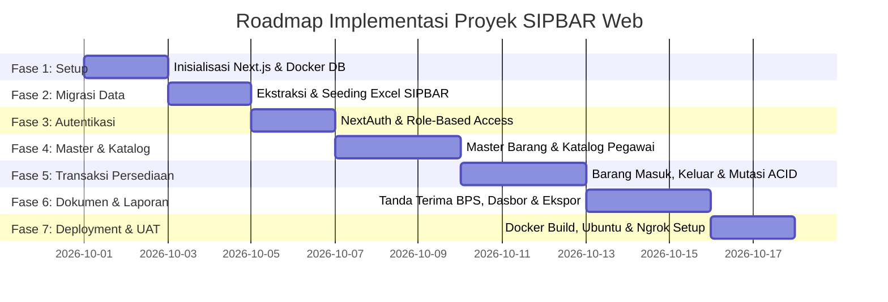

# RENCANA TAHAPAN & FASE PENGERJAAN PROYEK (FASE_PENGERJAAN.MD)

# SIPBAR WEB — SISTEM INFORMASI PERSEDIAAN BARANG

**Badan Pusat Statistik (BPS) Kabupaten Jeneponto**
*Panduan Rinci Langkah Eksekusi Berurutan untuk AI Coding Agent & Tim Pengembang*

---

## 1. PANDUAN PENGGUNAAN DOKUMEN FASE

Dokumen ini adalah **peta jalan eksekusi (*Execution Roadmap*)** yang memandu AI Agent dalam membangun aplikasi **SIPBAR Web** secara bertahap dari nol hingga siap dideploy ke server produksi.

### Aturan Eksekusi bagi AI Agent:

1. **Wajib Berurutan (*Strict Sequential Execution*)**: Kerjakan fase secara berurutan mulai dari **Fase 1** hingga **Fase 7**. Jangan melompati fase sebelum fase sebelumnya terverifikasi.
2. **Kepatuhan Terhadap Dokumentasi Proyek**: Setiap penulisan kode pada tiap fase wajib merujuk kepada:
   * `PRD.md` (Kebutuhan & Fitur)
   * `SYSTEM_DESIGN.md` (Alur Kerja & Logika Bisnis)
   * `ARSITEKTUR.md` (Blueprint Teknis & Struktur Folder)
   * `DATABASE.md` (Skema Tabel & Integritas ACID)
   * `API.md` (Kontrak Server Actions & REST API)
   * `UI_UX.md` (Standar Desain BPS Modern Executive)
   * `AGENT.md` (Aturan Kerja & Testing)
3. **Verifikasi Setiap Sub-Task**: Tandai centang `[x]` pada setiap sub-task setelah diuji dan dipastikan berfungsi tanpa error kompilasi/runtime.

---

## 2. RINGKASAN TIMELINE FASE PENGEMBANGAN

---

## 3. RINCIAN LANGKAH EKSEKUSI PER FASE

---

### FASE 1: INISIALISASI PROYEK, BASIS DATA & INFRASTRUKTUR DOCKER

> **Tujuan**: Menyiapkan fondasi lingkungan aplikasi, UI library, basis data PostgreSQL, dan container Docker.

- [x] **Task 1.1: Setup Proyek Next.js & TypeScript**
  - Inisialisasi proyek Next.js 14/15 App Router dengan TypeScript, Tailwind CSS, dan ESLint.
  - Pasang dependensi inti: `@prisma/client`, `prisma`, `lucide-react`, `clsx`, `tailwind-merge`, `zod`, `react-hook-form`, `bcryptjs`, `next-auth`, `exceljs`, `recharts`.
  - Konfigurasi tema warna resmi BPS di `tailwind.config.ts` sesuai standar `UI_UX.md` (Navy `#0F2F64`, Sky Blue `#0284C7`, Orange `#F97316`, Slate `#F8FAFC`).
- [x] **Task 1.2: Setup Komponen UI (Shadcn UI / Radix Primitives)**
  - Setup komponen dasar di `src/components/ui/`: `Button`, `Input`, `Dialog/Modal`, `Table`, `Badge`, `Select`, `DropdownMenu`, `Card`, `Toast/Toaster`, `Skeleton`.
- [x] **Task 1.3: Konfigurasi Basis Data PostgreSQL & Prisma ORM**
  - Buat file `docker-compose.yml` untuk container database PostgreSQL 16 Alpine dengan persistent volume `postgres_data`.
  - Tulis skema lengkap di `prisma/schema.prisma` sesuai `DATABASE.md` (Tabel: `users`, `fungsi`, `kategori`, `satuan`, `gudang`, `barang`, `transaksi_masuk`, `transaksi_keluar`, `tanda_terima`).
  - Buat singleton Prisma Client di `src/lib/prisma.ts`.
  - Jalankan migrasi basis data pertama: `npx prisma migrate dev --name init_database`.
- [x] **Task 1.4: Endpoint Health Check**
  - Buat endpoint `src/app/api/health/route.ts` untuk memverifikasi koneksi aplikasi dengan database PostgreSQL.

---

### FASE 2: MIGRASI DATA HISTORIS EXCEL & SEEDING AWAL

> **Tujuan**: Memindahkan seluruh data master dan riwayat transaksi dari berkas `SIPBAR.xlsm` ke database PostgreSQL.

- [x] **Task 2.1: Pembuatan Skrip Seeder Master Referensi**
  - Tulis skrip `prisma/seed.ts` untuk memuat data baku:
    * **9 Seksi/Fungsi**: `KEPALA SATKER`, `UMUM`, `DISTRIBUSI`, `IPDS`, `NERACA`, `PRODUKSI`, `SOSIAL`, `SECURITY`, `CLEANING SERVICES`.
    * **27 Kategori Barang**: `Kertas HVS`, `Tinta/Toner Printer`, `Stopmap`, `Alat Perekat`, `Komputer Supplies`, dll.
    * **14 Satuan**: `Rim`, `Botol`, `Buah`, `Pack`, `Box`, `Lembar`, `Pcs`, dll.
    * **3 Gudang**: `Gudang 1`, `Gudang 2`, `Gudang 3`.
    * **Akun Pengguna Default**: Super Admin (`superadmin`) dan Admin Gudang (`admingudang`).
- [x] **Task 2.2: Skrip Migrasi Data Historis Excel**
  - Buat skrip pembaca `SIPBAR.xlsm` (menggunakan parser Node.js / Python helper) untuk mengimpor:
    * **316 Master Barang** dari sheet `DATABARANG` (Kode `ID-1000001` s.d. `ID-1000327`, nama, satuan, kategori, gudang, saldo awal).
    * **647 Transaksi Masuk** dari sheet `BARANGMASUK` (Kode `BM-1000001` s.d. `BM-1000649`, tanggal, kuantitas, harga, vendor).
    * **486 Transaksi Keluar** dari sheet `BARANGKELUAR` (Kode `BK-1000001` s.d. `BK-1000534`, tanggal, kuantitas, nama pegawai penerima, seksi fungsi).
- [x] **Task 2.3: Rekonsiliasi & Validasi Integritas Saldo**
  - Jalankan skrip verifikasi untuk mencocokkan total saldo stok fisik akhir di PostgreSQL dengan Excel ($489$ unit di Gudang 2).

---

### FASE 3: AUTENTIKASI, OTORISASI RBAC & MANAJEMEN USER

> **Tujuan**: Membangun sistem login aman, proteksi rute halaman, dan manajemen akun pegawai.

- [x] **Task 3.1: Konfigurasi NextAuth.js v5**
  - Buat konfigurasi auth di `src/lib/auth.ts` dengan Credentials Provider.
  - Implementasikan hashing kata sandi dengan `bcryptjs` (12 salt rounds).
  - Simpan payload JWT sesi: `{ id, name, username, role, fungsiId }`.
- [x] **Task 3.2: Middleware Proteksi Rute (`middleware.ts`)**
  - Kunci rute `/dashboard`, `/inventaris`, `/transaksi-masuk`, `/transaksi-keluar`, `/laporan` hanya untuk `ADMIN_GUDANG` dan `SUPER_ADMIN`.
  - Kunci rute `/pengaturan/users` khusus untuk role `SUPER_ADMIN`.
  - Izinkan rute `/katalog` diakses oleh seluruh pengguna dan publik LAN.
- [x] **Task 3.3: Halaman Login (`/login`)**
  - Bangun antarmuka login bersih berlogo BPS Jeneponto sesuai standar `UI_UX.md`.
  - Tangani validasi Zod form login, loading spinner submit, dan penanganan error invalid credentials.
- [x] **Task 3.4: Modul Manajemen Pengguna (`/pengaturan/users`)**
  - Buat Server Actions `src/actions/users.actions.ts`: `createUser`, `updateUserRole`, `resetUserPassword`.
  - Bangun halaman tabel daftar pegawai BPS Jeneponto, modal tambah akun, dan aksi reset password.

---

### FASE 4: MASTER DATA PERSEDIAAN & KATALOG PUBLIK PEGAWAI

> **Tujuan**: Membangun katalog pencarian stok mandiri untuk staf dan pengelolaan data master barang.

- [x] **Task 4.1: Helper Pembuat Kode Otomatis (`code-generator.ts`)**
  - Tulis algoritma generator kode sekuensial di `src/lib/code-generator.ts` untuk `ID-1000xxx`, `BM-YYYYMM-xxxx`, `BK-YYYYMM-xxxx`, dan `TT-YYYYMM-xxxx`.
- [x] **Task 4.2: Server Actions Master Barang (`barang.actions.ts`)**
  - Implementasikan Server Actions: `getBarangList`, `createBarang`, `updateBarang`, `deleteBarang`.
  - Pasang validasi aturan bisnis: tolak hapus barang jika memiliki histori transaksi (`transaksi_masuk` atau `transaksi_keluar`).
- [x] **Task 4.3: Halaman Katalog Publik Pegawai (`/katalog`)**
  - Bangun halaman pencarian stok terbuka untuk staf BPS.
  - Implementasikan pencarian instan nama barang (*debounced live search*).
  - Filter chips berdasarkan Kategori dan Lokasi Gudang.
  - Tampilkan Badge Ketersediaan resmi (*Tersedia / Menipis / Habis*).
- [x] **Task 4.4: Halaman Inventaris Admin (`/inventaris`)**
  - Bangun tabel manajemen master barang untuk Admin Gudang (CRUD).
  - Modal form tambah & edit barang dengan upload foto barang (opsional).

---

### FASE 5: MODUL TRANSAKSI PERSEDIAAN & MUTASI STOK ACID

> **Tujuan**: Membangun modul pencatatan pengadaan (masuk) dan distribusi (keluar) dengan kepatuhan transaksi ACID anti-minus.

- [x] **Task 5.1: Modul Transaksi Barang Masuk (`/transaksi-masuk`)**
  - Buat Server Actions `src/actions/masuk.actions.ts`: `getTransaksiMasukList`, `createTransaksiMasuk`, `deleteTransaksiMasuk`.
  - **Logika ACID**: Buka `prisma.$transaction`, insert record log, dan tambahkan nilai `barang.stok`.
  - Bangun halaman riwayat pengadaan dan form entri barang masuk `/transaksi-masuk/baru` dengan autocomplete barang.
- [x] **Task 5.2: Modul Transaksi Barang Keluar (`/transaksi-keluar`)**
  - Buat Server Actions `src/actions/keluar.actions.ts`: `getTransaksiKeluarList`, `createTransaksiKeluar`, `deleteTransaksiKeluar`.
  - **Logika ACID & Anti-Minus**: Buka `prisma.$transaction`, lock baris barang, validasi `stok >= jumlahKeluar`. Jika tidak cukup $\rightarrow$ gagalkan transaksi. Jika cukup $\rightarrow$ insert log dan kurangi `barang.stok`.
  - Bangun form entri pengeluaran `/transaksi-keluar/baru` dengan dropdown 35 Pegawai Penerima dan 9 Seksi/Fungsi BPS Jeneponto.
  - Sediakan kalkulator sisa stok live di form input.

---

### FASE 6: DOKUMEN TANDA TERIMA, LAPORAN & DASBOR EKSEKUTIF

> **Tujuan**: Menerbitkan Berita Acara resmi format BPS, dasbor analitik persediaan, dan ekspor laporan Excel.

- [x] **Task 6.1: Generator Dokumen Tanda Terima Resmi (`/tanda-terima`)**
  - Buat Server Actions `src/actions/terima.actions.ts`: `createTandaTerima`, `getTandaTerimaDetail`.
  - Bangun halaman kompilasi `/tanda-terima/buat`: Admin memilih beberapa transaksi pengeluaran hari ini untuk digabung menjadi 1 dokumen Berita Acara penyerahan.
  - Bangun halaman cetak `/tanda-terima/[id]/cetak` dengan Kop Surat BPS Kabupaten Jeneponto, logo resmi, tabel rincian barang, kolom tanda tangan penerima, dan pengesahan Kasubbag Umum (*Imaniar Dwi Aryanti, S.TP*).
  - Terapkan CSS `@media print` presisi ukuran kertas F4/A4 portrait.
- [x] **Task 6.2: Dasbor Eksekutif & Monitoring Stok Kritis (`/dashboard`)**
  - Bangun 4 Kartu KPI Metrik (Total Varian Barang, Total Saldo Fisik, Mutasi Masuk Bulan Ini, Mutasi Keluar Bulan Ini).
  - Widget rincian saldo per gudang (Gudang 1, 2, 3).
  - Grafik tren pengeluaran ATK per bulan dan proporsi distribusi per fungsi kerja menggunakan `Recharts`.
  - Tabel Peringatan Stok Kritis (*Low-Stock Alert Table* untuk item dengan $stok \le 5$).
- [x] **Task 6.3: Modul Laporan & Ekspor Excel (`/laporan`)**
  - Buat endpoint API `src/app/api/export/excel/route.ts` menggunakan library `ExcelJS`.
  - Bangun form filter periode tanggal laporan mutasi masuk dan keluar.
  - Generate file `.xlsx` terformat rapi dengan Kop Laporan BPS Jeneponto dan total kuantitas.

---

### FASE 7: TESTING, CONTAINER BUILD & DEPLOYMENT UBUNTU SERVER

> **Tujuan**: Memastikan keandalan sistem, membangun image Docker produksi, dan memasang aplikasi di server kantor BPS Jeneponto.

- [x] **Task 7.1: Pengujian Fungsionalitas End-to-End (UAT Testing)**
  - Uji alur lengkap: Input Barang Baru $\rightarrow$ Transaksi Masuk (stok bertambah) $\rightarrow$ Cek Katalog Pegawai $\rightarrow$ Transaksi Keluar (stok berkurang) $\rightarrow$ Cetak Tanda Terima PDF $\rightarrow$ Cek Dasbor KPI & Ekspor Excel.
  - Uji kasus batas (*Edge Cases*): Coba paksa pengeluaran melebihi stok, coba hapus master barang yang memiliki transaksi, coba akses halaman admin tanpa login.
- [x] **Task 7.2: Pembuatan Dockerfile Multi-Stage Production**
  - Tulis berkas `Dockerfile` multi-stage build (deps, builder, runner) yang menghasilkan container ringan (*Node.js Alpine standalone*).
  - Uji coba build container lokal: `docker compose up --build -d`.
- [x] **Task 7.3: Deployment ke Server Ubuntu Kantor BPS & Setup Ngrok**
  - Clone repositori ke komputer server Ubuntu kantor BPS Jeneponto.
  - Setup environment `.env` produksi.
  - Jalankan container database PostgreSQL dan web Next.js via Docker Compose.
  - Konfigurasi autostart service container (`restart: always`).
  - Konfigurasi **Ngrok Tunneling** sebagai systemd service pada Ubuntu untuk akses remote publik HTTPS.
  - Uji coba akses dari jaringan LAN kantor (`http://192.168.1.xxx:3000`) dan dari luar kantor via URL Ngrok.

---

## 4. CHECKLIST KESIAPAN SEBELUM GO-LIVE

Sebelum sistem resmi digunakan sebagai pengganti file Excel `SIPBAR.xlsm`, pastikan checklist berikut terverifikasi:

- [x] Seluruh 316 data master barang telah terverifikasi di PostgreSQL.
- [x] Total saldo stok fisik di sistem web sama persis dengan fisik di gudang ($489$ unit).
- [x] Seluruh akun staf pegawai dan seksi kerja BPS Jeneponto telah terdaftar.
- [x] Format cetak Tanda Terima telah disetujui oleh Kasubbag Umum BPS Jeneponto.
- [x] Backup otomatis database PostgreSQL (`pg_dump` cron job) telah dikonfigurasi di server Ubuntu.
- [x] Akses LAN kantor dan Ngrok tunnel berjalan stabil tanpa hambatan.

---

## 5. KESIMPULAN

Rencana tahapan kerja pada dokumen **`FASE_PENGERJAAN.md`** ini memberikan jalur instruksi yang presisi, bertahap, dan tidak menyisakan ruang keraguan bagi AI Coding Agent maupun tim pengembang. Dengan mengikuti panduan fase ini secara disiplin, aplikasi **SIPBAR Web** akan selesai dibangun dengan kualitas tinggi, bebas dari bug data persediaan, dan siap beroperasi penuh melayani kebutuhan **BPS Kabupaten Jeneponto**.
