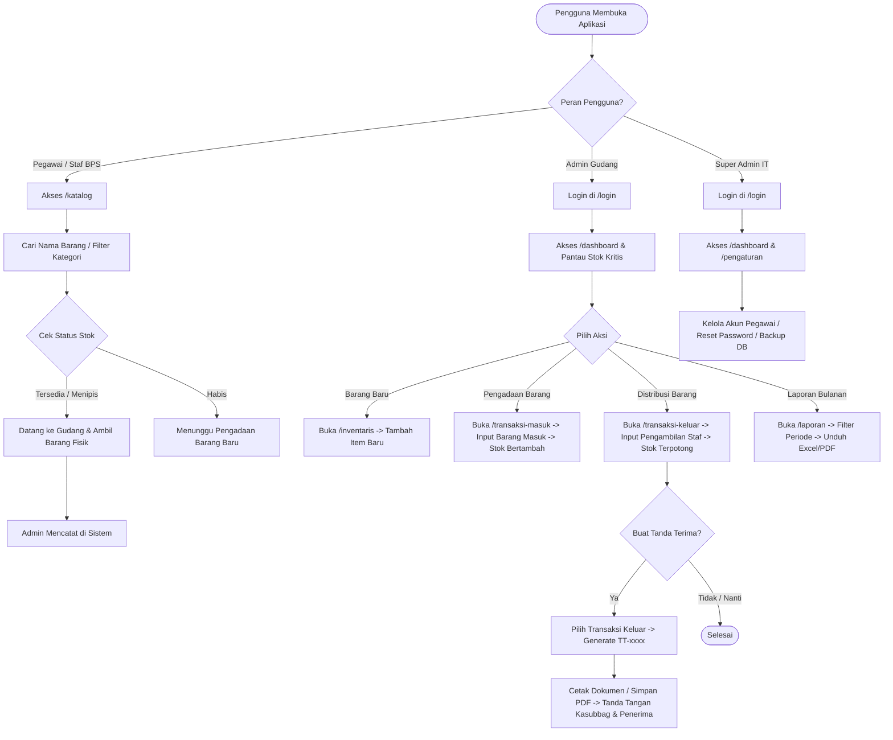
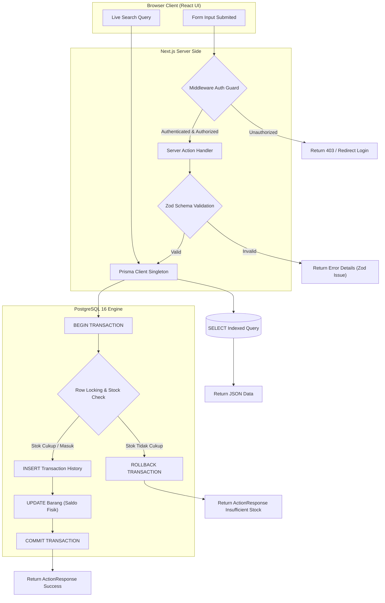
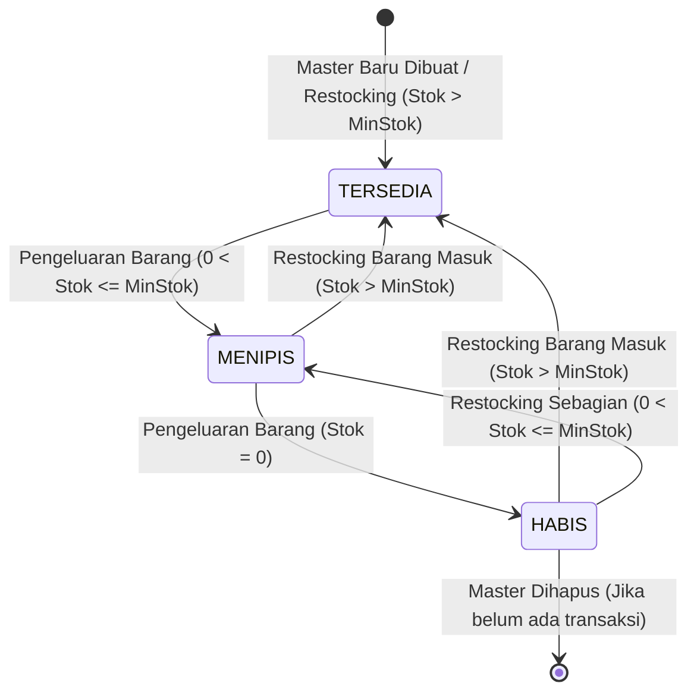
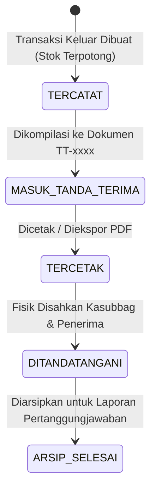

# SYSTEM DESIGN DOCUMENT (SDD)
# SIPBAR WEB — SISTEM INFORMASI PERSEDIAAN BARANG
**Badan Pusat Statistik (BPS) Kabupaten Jeneponto**
*Dokumen Desain Alur Kerja, Logika Bisnis, Interaksi Fitur, dan Mekanisme Internal Sistem*

---

## 1. SYSTEM OVERVIEW

**SIPBAR Web** adalah aplikasi manajemen persediaan barang berbasis web yang mentransformasi dan memodernisasi sistem operasional inventaris di **Badan Pusat Statistik (BPS) Kabupaten Jeneponto**.

### Prinsip Kerja Sistem:
1. **Penyimpanan Terpusat & Multi-User**: Seluruh data master, transaksi masuk (*restocking*), transaksi keluar (*distribusi*), dan dokumen legalitas dikelola dalam satu basis data relasional terpusat (PostgreSQL).
2. **Katalog Terbuka untuk Pegawai**: Pegawai internal BPS dapat melihat ketersediaan stok fisik ATK/perlengkapan kantor secara mandiri (*self-service catalog*) tanpa harus login sebagai admin.
3. **Pencatatan Terkontrol oleh Admin Gudang**: Seluruh transaksi fisik masuk dan keluar dicatat secara terpusat oleh Admin Gudang, di mana setiap penambahan/pengurangan kuantitas langsung memutasi saldo fisik persediaan secara atomik (*ACID Transactions*).
4. **Penerbitan Berita Acara / Tanda Terima Otomatis**: Transaksi pengeluaran barang dapat langsung dikelompokkan menjadi lembar Tanda Terima resmi berformat standar BPS siap cetak / PDF.
5. **Pemantauan & Audit Terintegrasi**: Dasbor eksekutif menyajikan indikator KPI persediaan, grafik tren mutasi bulanan, peringatan otomatis barang yang stoknya menipis (*low-stock alert*), serta rekam jejak audit (*audit trail*) siapa admin yang melakukan transaksi.

---

## 2. ACTORS & ROLES

Sistem mendefinisikan 3 aktor utama dengan wewenang dan batasan operasional sebagai berikut:

```
+----------------------------------------------------------------------------------------------------+
|                                         AKTOR & PERAN SISTEM                                       |
+----------------------------------------------------------------------------------------------------+
| 1. SUPER ADMIN (Tim IT BPS)                                                                        |
|    - Tanggung Jawab: Pemeliharaan infrastruktur, manajemen pengguna, dan keamanan sistem.         |
|    - Aktivitas Utama: Menambah akun pengguna, mengubah peran (role), mereset kata sandi,           |
|      mengelola data referensi (Kategori, Satuan, Gudang, Seksi/Fungsi), backup database, dan       |
|      memantau audit log & status server.                                                           |
+----------------------------------------------------------------------------------------------------+
| 2. ADMIN GUDANG (Staf Subbagian Umum / Pengelola Barang)                                           |
|    - Tanggung Jawab: Operasional harian pengelolaan fisik barang persediaan.                       |
|    - Aktivitas Utama: Mengelola master barang (CRUD), mencatat pengadaan barang masuk,             |
|      mencatat distribusi barang keluar ke pegawai/seksi, menerbitkan lembar Tanda Terima resmi,    |
|      mencetak/mengekspor laporan mutasi ke Excel/PDF, dan memantau stok kritis di dasbor.          |
+----------------------------------------------------------------------------------------------------+
| 3. PEGAWAI / USER (Seluruh Staf & Pegawai BPS Kabupaten Jeneponto)                                 |
|    - Tanggung Jawab: Penerima manfaat barang persediaan.                                           |
|    - Aktivitas Utama: Mengakses halaman katalog publik untuk mengecek ketersediaan stok barang,    |
|      melihat lokasi gudang penyimpanan, serta melihat status ketersediaan barang secara mandiri.   |
|    - Catatan: Sesuai aturan bisnis, pegawai tidak melakukan approval permohonan mandiri, melainkan |
|      langsung meminta ke gudang dan dicatat oleh Admin Gudang.                                     |
+----------------------------------------------------------------------------------------------------+
```

---

## 3. FEATURE FLOW

Berikut adalah alur terperinci dari setiap fitur utama, mencakup masukan (input), proses internal, validasi bisnis, serta keluaran (output) kondisi berhasil dan gagal:

### 3.1 Fitur: Manajemen Master Barang (CRUD Master)
* **Aktor**: Admin Gudang / Super Admin
* **Input**: Nama Barang, Kategori ID, Satuan ID, Gudang ID, Minimum Stok (*Safety Stock*), Estimasi Harga Satuan, Foto Barang (opsional).
* **Proses**:
  1. Sistem mengenerate kode unik otomatis jika belum ada (`ID-1000xxx`).
  2. Memeriksa apakah nama barang sudah terdaftar pada kategori yang sama.
  3. Menginisialisasi stok fisik $= 0$ untuk barang baru (atau nilai saldo awal jika migrasi).
  4. Menyimpan record ke tabel `barang`.
* **Validasi**:
  * Nama barang wajib diisi (minimal 3 karakter).
  * Kategori, Satuan, dan Gudang wajib valid (merujuk ke master referensi aktif).
  * Nilai `minStok` $\ge 0$.
* **Output**:
  * *Berhasil*: Master barang tersimpan, notifikasi toast sukses muncul, data langsung tampil di katalog.
  * *Gagal*: Muncul pesan error validasi pada field terkait.

### 3.2 Fitur: Pencatatan Transaksi Barang Masuk (*Restocking*)
* **Aktor**: Admin Gudang / Super Admin
* **Input**: Tanggal Masuk, Pilihan Barang (Autocomplete), Kuantitas Masuk, Harga Beli Satuan (opsional), Sumber Pengadaan/Vendor, Keterangan.
* **Proses**:
  1. Sistem mengenerate kode transaksi masuk otomatis (`BM-YYYYMM-xxxx`).
  2. Membuka blok transaksi database ACID (`prisma.$transaction`).
  3. Menulis baris riwayat ke tabel `transaksi_masuk`.
  4. Menambah kolom `stok` pada tabel `barang` sebesar `stok_baru = stok_lama + jumlah_masuk`.
  5. Menutup dan meng-commit transaksi database.
* **Validasi**:
  * Kuantitas masuk wajib integer positif ($> 0$).
  * Barang ID wajib terdaftar di database.
* **Output**:
  * *Berhasil*: Transaksi masuk tercatat, stok barang otomatis bertambah, dasbor terbarui.
  * *Gagal*: Transaksi di-rollback, muncul pesan error, saldo stok tidak berubah.

### 3.3 Fitur: Pencatatan Transaksi Barang Keluar (*Distribution*)
* **Aktor**: Admin Gudang / Super Admin
* **Input**: Tanggal Keluar, Pilihan Barang, Kuantitas Keluar, Nama Pegawai Penerima, Seksi/Fungsi Tujuan, Keterangan.
* **Proses**:
  1. Sistem mengenerate kode transaksi keluar otomatis (`BK-YYYYMM-xxxx`).
  2. Membuka blok transaksi database ACID (`prisma.$transaction`).
  3. Membaca dan mengunci baris barang (*row locking*), lalu memeriksa saldo stok saat ini.
  4. Jika `stok_saat_ini >= jumlah_keluar`:
     * Menulis baris riwayat ke tabel `transaksi_keluar`.
     * Memotong kolom `stok` pada tabel `barang` sebesar `stok_baru = stok_lama - jumlah_keluar`.
     * Commit transaksi.
  5. Jika `stok_saat_ini < jumlah_keluar`:
     * Rollback transaksi dan lempar *InsufficientStockException*.
* **Validasi**:
  * Kuantitas keluar $> 0$.
  * Kuantitas keluar $\le$ Stok fisik yang tersedia.
  * Nama Penerima dan Fungsi Tujuan wajib diisi.
* **Output**:
  * *Berhasil*: Transaksi keluar tercatat, stok master langsung terpotong, notifikasi sukses.
  * *Gagal*: Error "Kuantitas pengeluaran melebihi stok yang tersedia (Sisa stok: X)".

### 3.4 Fitur: Generator Dokumen Resmi Tanda Terima (Berita Acara)
* **Aktor**: Admin Gudang / Super Admin
* **Input**: Pemilihan beberapa ID transaksi pengeluaran barang (`transaksiKeluarIds[]`), Tanggal Dokumen.
* **Proses**:
  1. Mengenerate nomor dokumen Tanda Terima otomatis (`TT-YYYYMM-xxxx`).
  2. Menyimpan data header dokumen ke tabel `tanda_terima`.
  3. Mengaitkan field `tandaTerimaId` pada setiap baris `transaksi_keluar` yang dipilih.
  4. Merender tampilan halaman cetak resmi lengkap dengan Kop BPS Kabupaten Jeneponto, rincian tabel barang, kolom tanda tangan penerima, dan tanda tangan Kasubbag Umum BPS Jeneponto.
* **Validasi**:
  * Minimal harus memilih 1 transaksi keluar.
  * Transaksi keluar yang dipilih belum pernah dikaitkan dengan dokumen Tanda Terima lain.
* **Output**:
  * *Berhasil*: Lembar Tanda Terima terbit dan siap dicetak (*Print View*) atau diunduh sebagai PDF.
  * *Gagal*: Muncul notifikasi "Transaksi yang dipilih sudah memiliki Tanda Terima".

### 3.5 Fitur: Katalog Publik & Cek Ketersediaan Pegawai
* **Aktor**: Seluruh Pegawai / Publik (LAN)
* **Input**: Kata kunci pencarian nama barang, Filter Kategori, Filter Lokasi Gudang.
* **Proses**:
  1. Frontend mengirim parameter query secara live (debounced search).
  2. Server melakukan pencarian case-insensitive pada field `namaBarang` dan filter `kategoriId` / `gudangId`.
  3. Menghitung badge ketersediaan berdasarkan nilai `stok` vs `minStok`.
* **Output**:
  * Daftar kartu/tabel barang berisi: Nama Barang, Kategori, Satuan, Lokasi Gudang, Saldo Stok, dan Badge Status (*Tersedia / Menipis / Habis*).

---

## 4. USER FLOW



---

## 5. SYSTEM FLOW

Diagram di bawah menggambarkan aliran proses internal server saat mengeksekusi operasi transaksi dan rendering:



---

## 6. DATA FLOW ARCHITECTURE

```
[ Form Input (UI) ] 
       │
       ▼
[ Validasi Skema Zod (Sanitasi String, Validasi Tipe Integer/Decimal) ]
       │
       ▼
[ Server Actions (Autentikasi Sesi JWT & Otorisasi Role) ]
       │
       ▼
[ Prisma ORM Client (Query Builder Type-Safe) ]
       │
       ▼
[ PostgreSQL Database (ACID Transaction Block) ]
   ├── Transaksi Masuk  ──> (+) Update Saldo Fisik (barang.stok)
   ├── Transaksi Keluar ──> (-) Update Saldo Fisik (barang.stok)
   └── Tanda Terima     ──> (Relasi) Mengelompokkan transaksi_keluar.id
       │
       ▼
[ Query Output & Agregasi ]
   ├── Dasbor KPI (COUNT, SUM, SUMIF per Gudang)
   ├── Low-Stock Alert Table (WHERE stok <= minStok)
   ├── Halaman Cetak Tanda Terima (Kop BPS + Join Barang & Fungsi)
   └── Ekspor Laporan Mutasi (ExcelJS Binary Stream / PDF)
```

---

## 7. BUSINESS LOGIC & RULES

### 7.1 Aturan Penomoran Dokumen Otomatis (Auto-Numbering)
* **Master Barang**: Format `ID-1000xxx` di mana angka counter diambil secara sekuensial dari database.
* **Barang Masuk**: Format `BM-YYYYMM-xxxx` (contoh: `BM-202610-0001` untuk transaksi pertama di bulan Oktober 2026).
* **Barang Keluar**: Format `BK-YYYYMM-xxxx` (contoh: `BK-202610-0001`).
* **Tanda Terima**: Format `TT-YYYYMM-xxxx` (contoh: `TT-202610-0001`).

### 7.2 Aturan Saldo Stok Persediaan (Inventory Rules)
1. **Aturan Anti-Minus**: Saldo stok barang pada tabel `barang` **tidak boleh bernilai negatif** ($stok \ge 0$). Setiap pengeluaran barang wajib divalidasi `jumlahKeluar <= stok`.
2. **Kompensasi Stok pada Perubahan/Penghapusan Transaksi**:
   * Jika Transaksi Masuk dihapus: $Stok_{baru} = Stok_{lama} - JumlahMasuk$.
   * Jika Transaksi Keluar dihapus: $Stok_{baru} = Stok_{lama} + JumlahKeluar$.
   * Jika Kuantitas Transaksi Keluar diedit: $Stok_{baru} = Stok_{lama} + QtyKeluar_{lama} - QtyKeluar_{baru}$.
3. **Kategori Status Persediaan (*Stock Health Status*)**:
   * `HABIS`: Saldo stok $= 0$.
   * `MENIPIS` (*Low Stock*): Saldo stok $> 0$ dan $stok \le minStok$ (Default $minStok = 5$).
   * `TERSEDIA`: Saldo stok $> minStok$.

### 7.3 Aturan Tanda Terima Resmi BPS Jeneponto
1. **Multi-Item Grouping**: Beberapa transaksi pengeluaran barang yang ditujukan kepada pegawai yang sama atau seksi fungsi yang sama pada periode yang sama dapat digabungkan ke dalam **satu dokumen Tanda Terima**.
2. **Penetapan Pejabat Penandatangan**: Secara default dokumen mencantumkan:
   * *An. Kepala BPS Kabupaten Jeneponto*
   * *Kepala Subbagian Umum: Imaniar Dwi Aryanti, S.TP*
   * Dilengkapi kolom tanda tangan dan nama terang pegawai penerima barang.

### 7.4 Aturan Hak Akses & Workflow Penyaluran
* `[FITUR BARU]`: Pegawai biasa **tidak memerlukan approval workflow berjenjang** untuk mengambil barang di sistem. Pegawai cukup datang ke gudang, staf gudang mengecek ketersediaan fisik dan menginput transaksi pengeluaran di sistem secara langsung.

---

## 8. STATE & STATUS MANAGEMENT

### 8.1 State Diagram Status Stok Barang



### 8.2 State Diagram Status Dokumen Transaksi & Tanda Terima



---

## 9. FEATURE INTERACTION & DEPENDENCY MATRIX

Diagram di bawah menunjukkan ketergantungan antar-modul di dalam sistem:

```
[ Master Referensi (Kategori, Satuan, Gudang, Fungsi) ]
                    │
                    ▼
[ Master Barang (ID-1000xxx) ] <────────────────────────+
      │                                                 │
      ├──> (Digunakan Pada) ──> [ Transaksi Masuk ] ───(+) Mutasi Stok
      │                                                 │
      └──> (Digunakan Pada) ──> [ Transaksi Keluar ] ──(-) Mutasi Stok
                                      │
                                      ▼
                        [ Generator Tanda Terima ]
                                      │
                                      ▼
                        [ Laporan Mutasi & Dasbor KPI ]
```

---

## 10. AUTHENTICATION & AUTHORIZATION FLOW

1. **Login User**:
   * User memasukkan kredensial (Username / NIP dan Password).
   * Server Actions memvalidasi dengan hash Bcrypt di database.
   * Jika valid, sesi JWT dibuat dengan payload: `{ id, name, username, role, fungsiId }`.
2. **Role Gatekeeper (Middleware)**:
   * Setiap request dievaluasi oleh `middleware.ts`:
     * `/dashboard`, `/inventaris`, `/transaksi-masuk`, `/transaksi-keluar`, `/laporan` $\rightarrow$ Wajib `ADMIN_GUDANG` atau `SUPER_ADMIN`.
     * `/pengaturan/users` $\rightarrow$ Wajib `SUPER_ADMIN`.
     * `/katalog` $\rightarrow$ Akses Terbuka (*Public/All Roles*).
3. **Logout**:
   * Cookie sesi `next-auth.session-token` dihapus dan user dialihkan ke `/login`.

---

## 11. CRUD & TRANSACTION FLOW

| Entitas | Create (C) | Read (R) | Update (U) | Delete (D) |
| :--- | :--- | :--- | :--- | :--- |
| **Master Barang** | Tambah item baru, stok awal $= 0$. | Tampil di katalog publik & tabel inventaris admin. | Edit nama, kategori, satuan, gudang, minStok. *(Field stok tidak boleh diedit manual)*. | Hanya bisa dihapus jika **belum pernah memiliki riwayat transaksi**. |
| **Transaksi Masuk**| Input pengadaan, stok master **bertambah otomatis**. | Tabel riwayat masuk, filter per tanggal/nama. | Koreksi tanggal/keterangan/qty *(stok disesuaikan selisihnya)*. | Hapus transaksi *(stok master dipotong kembali)*. |
| **Transaksi Keluar**| Input distribusi, stok master **berkurang otomatis**. | Tabel riwayat keluar, filter per penerima/fungsi. | Koreksi tanggal/penerima/qty *(stok divalidasi & disesuaikan)*. | Hapus transaksi *(stok master dikembalikan)*. |
| **Tanda Terima** | Pilih transaksi keluar $\rightarrow$ generate lembar TT. | Daftar tanda terima terbit & pratinjau cetak. | Update tanggal dokumen / pejabat pengesah. | Pembatalan dokumen *(melepas relasi transaksi keluar)*. |

---

## 12. ERROR & EXCEPTION FLOW

1. **Validasi Gagal (*Validation Error*)**:
   * *Pemicu*: Field kosong, format tanggal tidak valid, kuantitas $< 0$.
   * *Penanganan*: Zod mengembalikan pesan error spesifik per kolom form $\rightarrow$ React Hook Form menampilkan pesan merah di bawah field input.
2. **Stok Tidak Mencukupi (*Insufficient Stock Exception*)**:
   * *Pemicu*: Admin menginput kuantitas keluar $> saldo$ stok yang ada.
   * *Penanganan*: Server Action menolak transaksi sebelum memotong stok $\rightarrow$ Melemparkan alert *"Kuantitas melebihi stok yang tersedia (Sisa: X unit)"*.
3. **Akses Ditolak (*Unauthorized / Forbidden 403*)**:
   * *Pemicu*: Pegawai biasa mencoba membuka URL `/pengaturan/users` atau memanggil Server Action admin.
   * *Penanganan*: Middleware mencegat request dan me-redirect pengguna ke `/katalog` dengan pesan peringatan.
4. **Koneksi Database Terputus (*Database Connection Error*)**:
   * *Pemicu*: Container PostgreSQL down atau reboot server.
   * *Penanganan*: Server Action menangkap error dan mengembalikan pesan *"Sistem sedang dalam pemeliharaan basis data, silakan coba beberapa saat lagi"*.

---

## 13. DASHBOARD & REPORTING FLOW

### 13.1 Pengolahan Data Dasbor
* **Kartu Total Persediaan**:
  ```sql
  SELECT COUNT(id) AS total_varian, SUM(stok) AS total_fisik FROM barang;
  ```
* **Kartu Stok per Lokasi Gudang**:
  ```sql
  SELECT g.nama, COALESCE(SUM(b.stok), 0) AS total_stok 
  FROM gudang g LEFT JOIN barang b ON b.gudang_id = g.id 
  GROUP BY g.nama;
  ```
* **Tabel Barang Kritis (*Low-Stock Alert*)**:
  ```sql
  SELECT * FROM barang WHERE stok <= min_stok ORDER BY stok ASC;
  ```

### 13.2 Pengolahan Laporan Mutasi & Ekspor Excel
1. Admin memilih jenis laporan (*Barang Masuk* atau *Barang Keluar*) dan menentukan rentang tanggal (*Tanggal Awal* s.d. *Tanggal Akhir*).
2. Server Action menarik data terfilter beserta relasi detail (Nama Barang, Kategori, Satuan, Gudang, Penerima, Fungsi).
3. Modul **ExcelJS** menyusun lembar spreadsheet `.xlsx` terformat rapi (Kop Laporan BPS Jeneponto, Header Kolom, Garis Tabel, dan Total Kuantitas).
4. File dikirim ke browser client sebagai stream binary unduhan otomatis.

---

## 14. END-TO-END WORKFLOW (SKENARIO LENGKAP OPERASIONAL BPS)

Berikut adalah simulasi alur komprehensif sistem dari awal tahun anggaran hingga tutup buku:

```
+----------------------------------------------------------------------------------------------------+
| 1. AWAL TAHUN / INISIALISASI                                                                       |
|    - Tim IT (Super Admin) memastikan container Docker aktif dan database terhubung.               |
|    - Admin Gudang mengecek saldo awal master barang di SIPBAR Web.                                 |
+----------------------------------------------------------------------------------------------------+
                                                  │
                                                  ▼
+----------------------------------------------------------------------------------------------------+
| 2. PENGADAAN BARANG MASUK (RESTOCKING)                                                             |
|    - Paket ATK baru tiba di kantor BPS Jeneponto dari vendor/DIPA.                                 |
|    - Admin Gudang membuka menu 'Barang Masuk' -> Masukkan data pengadaan.                          |
|    - Saldo stok fisik di sistem bertambah secara otomatis.                                         |
+----------------------------------------------------------------------------------------------------+
                                                  │
                                                  ▼
+----------------------------------------------------------------------------------------------------+
| 3. PEGAWAI MENGECEK KATALOG SECARA MANDIRI                                                         |
|    - Pegawai Seksi Produksi membutuhkan Kertas A4 & Tinta Printer.                                 |
|    - Pegawai membuka URL SIPBAR Web (/katalog) dari HP/Laptop -> Memastikan status 'Tersedia'.     |
+----------------------------------------------------------------------------------------------------+
                                                  │
                                                  ▼
+----------------------------------------------------------------------------------------------------+
| 4. PENYERAHAN BARANG & PENCATATAN DISTRIBUSI                                                       |
|    - Pegawai datang ke ruangan persediaan umum.                                                    |
|    - Admin Gudang menyerahkan barang fisik dan membuka menu 'Barang Keluar' di SIPBAR Web.         |
|    - Admin memilih barang, kuantitas keluar, nama pegawai penerima, dan seksi fungsinya.           |
|    - Stok barang langsung terpotong secara instan di sistem.                                       |
+----------------------------------------------------------------------------------------------------+
                                                  │
                                                  ▼
+----------------------------------------------------------------------------------------------------+
| 5. PENERBITAN & LEGALISASI TANDA TERIMA                                                            |
|    - Admin Gudang memilih transaksi pengeluaran hari itu -> Klik 'Buat Tanda Terima'.              |
|    - Sistem menerbitkan dokumen Berita Acara resmi (TT-202610-xxxx).                               |
|    - Dokumen dicetak/di-PDF-kan -> Ditandatangani Pegawai Penerima & Kasubbag Umum BPS Jeneponto.  |
+----------------------------------------------------------------------------------------------------+
                                                  │
                                                  ▼
+----------------------------------------------------------------------------------------------------+
| 6. MONITORING & PELAPORAN BULANAN / AKHIR TAHUN                                                    |
|    - Dasbor memberi peringatan jika ada item yang stoknya habis/menipis untuk diajukan pengadaan.  |
|    - Admin Gudang mengekspor Laporan Mutasi Barang Masuk & Keluar ke format Excel (.xlsx)          |
|      sebagai arsip pertanggungjawaban persediaan Barang Milik Negara (BMN) BPS Kabupaten Jeneponto.|
+----------------------------------------------------------------------------------------------------+
```

---

## 15. KESIMPULAN

Dokumen **System Design (SDD)** ini menetapkan alur operasional yang utuh, terstruktur, dan presisi bagi pembangunan **SIPBAR Web**. Dengan mengintegrasikan seluruh aturan bisnis dari berkas Excel sebelumnya serta menyempurnakannya dengan otomasi basis data relasional PostgreSQL, Next.js App Router, dan sistem hak akses bertingkat, sistem ini siap diimplementasikan secara langsung oleh developer maupun agen AI tanpa meninggalkan celah ketidakjelasan fungsionalitas.
